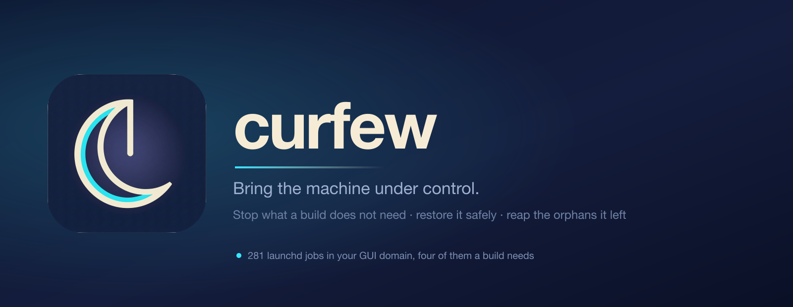
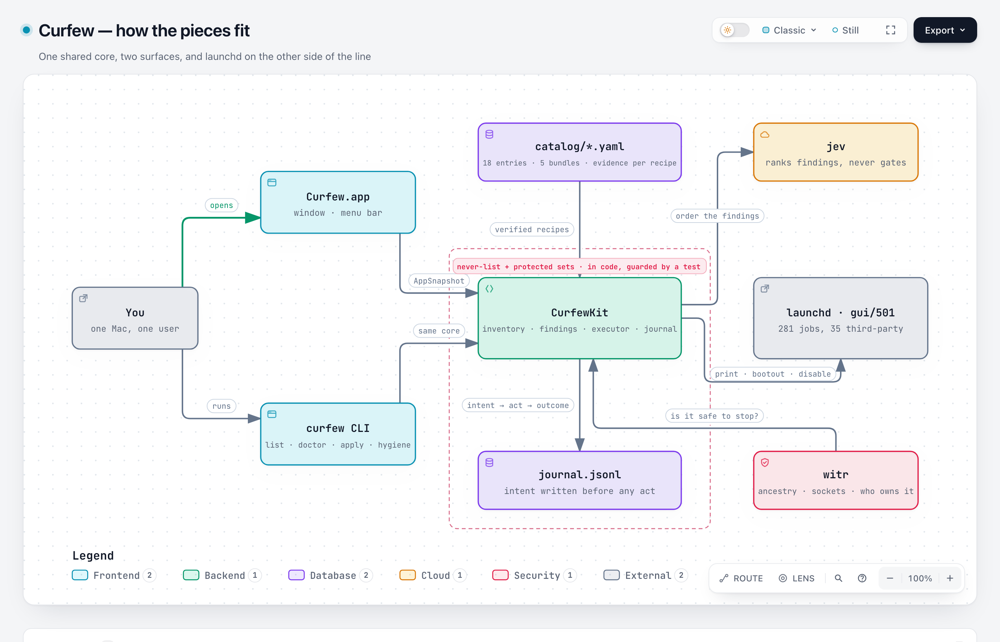
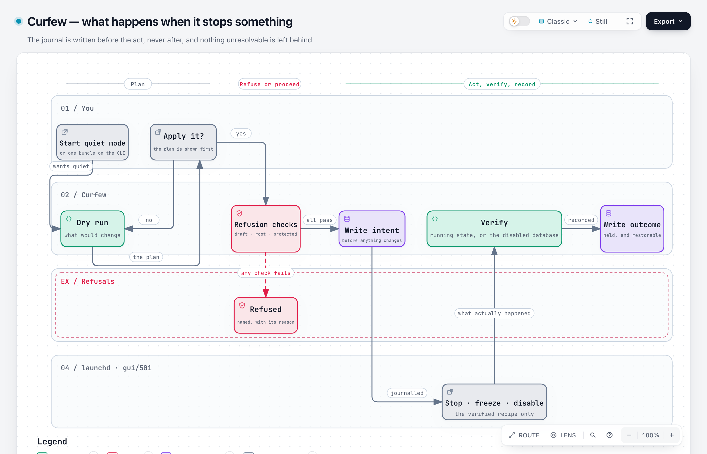
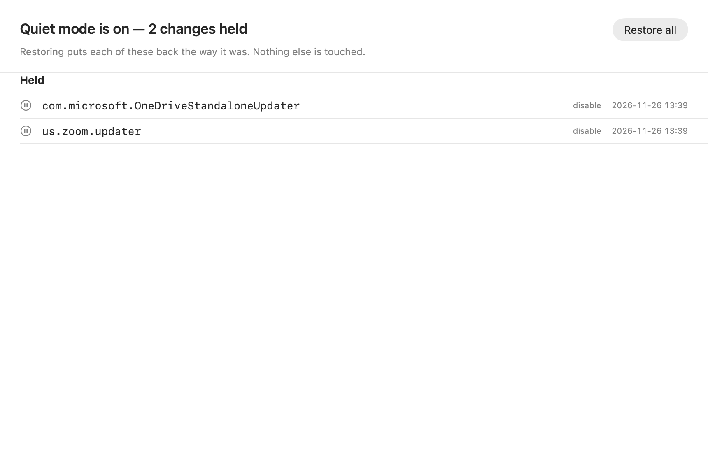
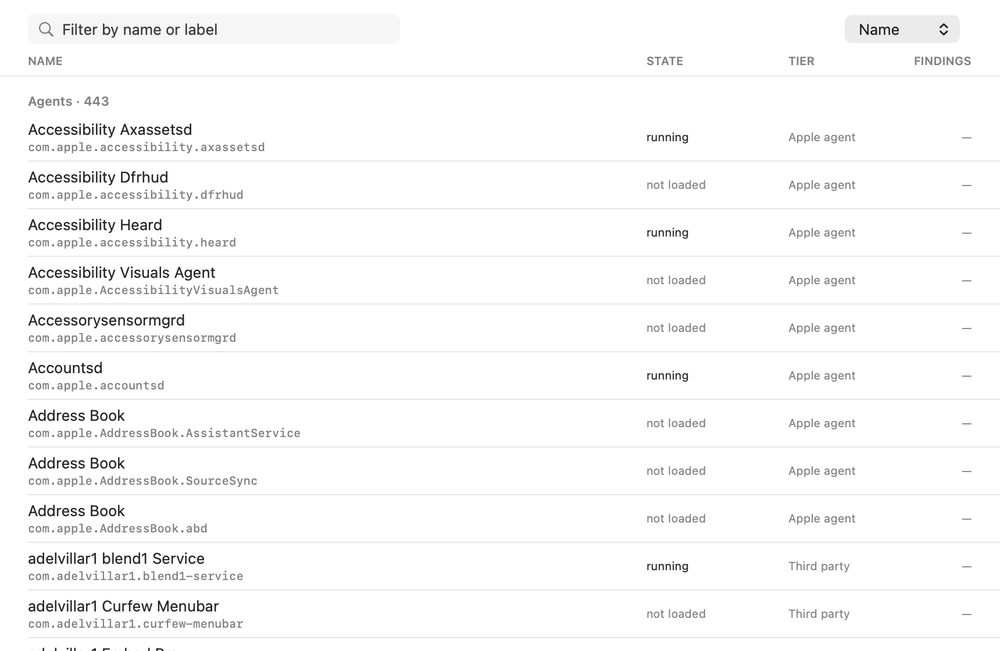
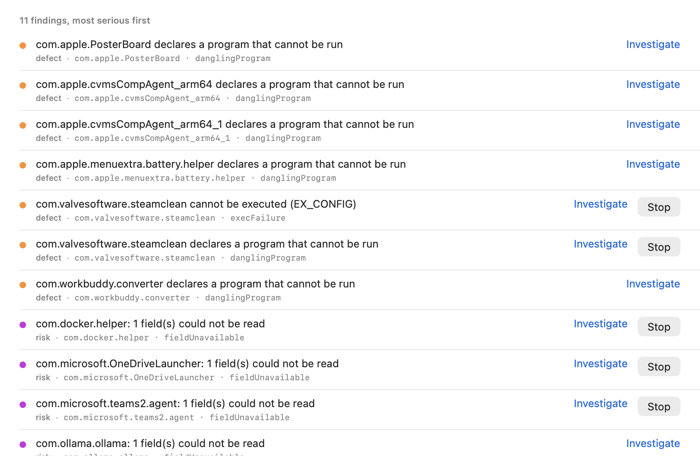
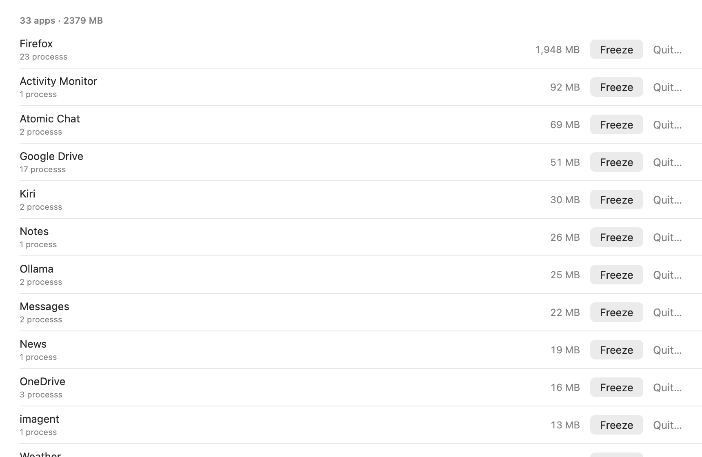
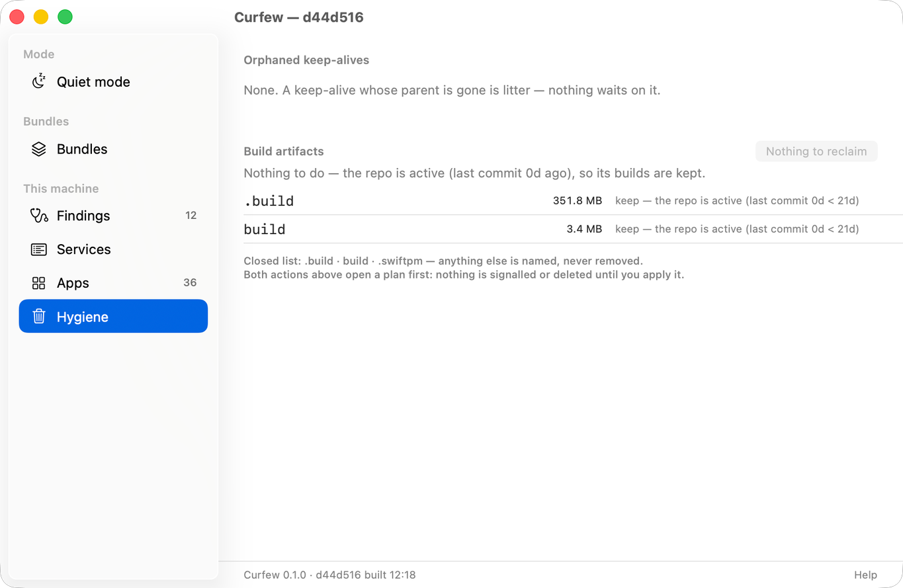

<p align="center">
  
</p>

<p align="center">
  <a href="#what-it-does">What it does</a> ·
  <a href="#how-it-decides">How it decides</a> ·
  <a href="#the-window">The window</a> ·
  <a href="#using-it">Using it</a> ·
  <a href="#safety">Safety</a> ·
  <a href="#credits">Credits</a>
</p>

Your Mac has been partying hard, fast, and loose — essentially an unruly teenager.

It is running 281 launchd jobs, thirty-one apps, thirteen updaters it never asked for, and at least one
keep-alive process that outlived the thing it was keeping alive. None of that is your build. Your build
needs node, git, a compiler, and four Apple daemons.

**Curfew is the parent that shows up at 11pm and turns the lights on.** It puts the machine into a quiet,
unattended-development state — stopping exactly the things a build does not need — and then it puts every
one of them back, the way it found it, when you say so.

## What it does

- **Reads the machine.** 281 jobs in the user domain, their state, their plists, their crash counters, and
  the findings that fall out of them: programs that no longer exist, configs that cannot be read, jobs
  respawning on a dangling symlink, apps that were uninstalled and left debris behind.
- **Stops what a build does not need** — vendor updaters, launchers, sync agents — through a catalogue of
  **18 entries** with a verified stop and start recipe each, and never anything on the never-list.
- **Restores exactly what it stopped.** The journal is written *before* the act, never after. A crash
  between intent and outcome is recovered on the next start; a service you had off stays off.
- **Quarantines debris** left by removed apps (moved, never deleted) when the owner is verifiably gone.
- **Freezes GUI apps** — the reversible lever — and shows you where the memory actually is: the apps hold
  ~2.4–4 GB, the daemons hold ~20 MB.
- **Reaps orphaned keep-alives** whose parent is gone: on this machine 1,232 of them once held 580 MB and
  46% of `maxprocperuid`.
- **Keeps its own house** — build artifacts pruned from a stale repo, orphans reaped, a session close that
  never deletes a record.

## How it decides

<p align="center">
  <a href="docs/diagrams/curfew-architecture.html"></a>
</p>

**One core, two surfaces.** `CurfewKit` holds the inventory, the findings engine, the executor and the
journal. The SwiftUI window and the `curfew` CLI are both thin surfaces over it — the window can never be a
second implementation of a mutation.

<p align="center">
  <a href="docs/diagrams/curfew-apply.html"></a>
</p>

**Every stop is a plan first.** Dry run → refusion checks (draft entries, root recipes, protected ports, the
never-list, Curfew's own pid) → journal the intent → act → verify → journal the outcome. Only a *failed*
action stops a run; an unverified stop is reported and the run continues.

## The window

| Quiet mode | Services |
|---|---|
|  |  |

| Findings | Apps | Hygiene |
|---|---|---|
|  |  |  |

Rows speak English, not launchd: `application.com.apple.ActivityMonitor.1152…1908417` reads as **Activity
Monitor**, with the real label kept underneath for the CLI. Every row's action matches its state — a frozen
app offers Resume, a held service offers Start, and a control that cannot act says why.

## Using it

```bash
swift build                       # zero dependencies
swift run curfew list             # every job, with tier and findings (read-only)
swift run curfew doctor           # the aggregated verdict, grouped by severity
swift run curfew why <label>      # ancestry, sockets, source, warnings
swift run curfew catalog list     # entries, levers, bundles, protected ports
swift run curfew apply --bundle vendor-noise             # dry run — nothing is touched
swift run curfew apply --bundle vendor-noise --execute   # needs --yes off a TTY
swift run curfew resume           # preview the restore plan
swift run curfew hygiene          # build artifacts, orphans, and what a live run would do
make app                          # build Curfew.app
make install-app                  # install to ~/Applications with a login opener
make check                        # tests, ledgers, catalogue validation, crash test
```

There are three levers per service, chosen by what the service actually is:

| Lever | What it does | Where it is used |
|---|---|---|
| `freeze` | `SIGSTOP` — instant, reversible, the app never knows | GUI apps only |
| `stop` | `launchctl bootout` with a verified recipe | services holding a socket or a database |
| `disable` | `launchctl disable`, surviving the next load | updaters that would come straight back |

## Safety

The rules the tool will not bend, each one written after something broke without it:

1. **Tier 0/1 is untouchable** — the never-list lives in code, is guarded by a test, and is never
   configuration.
2. **Journal before acting** — no action without a written intent; an unreadable journal means restore and
   exit rather than guess.
3. **Dry run before any live change** — "easy mode" is not exempt.
4. **`SIGSTOP` is for GUI apps** — never a server with a listening socket or an on-disk database; a frozen
   server hangs its clients instead of failing them.
5. **No catalogue entry without a verified recipe** — a service ships with a stop, a start, a quiesce probe
   and an `evidence:` date, or it stays `draft` and cannot be applied.
6. **Never resurrect what we did not stop** — pre-existing state is preserved on restore.
7. **Whitelist by ancestry, not by name** — Curfew never suspends its own tree, the calling terminal, or the
   remote-access path.

Curfew is deliberate about what it will *not* do: it does not delete app debris (it moves it), it does not
touch on-demand XPC jobs, and it does not report a stop as successful until the state says so.

## Credits

**Curfew reads the machine with [witr](https://github.com/pranshuparmar/witr).** The `why` command's
ancestry chain, the sockets a job holds, and the "who owns this process" answer all come from witr — that
is what makes the freeze-versus-stop decision evidence instead of a guess, and what lets Curfew walk the
parent chain rather than matching on names. Thank you, it does the unglamorous half.

The findings ranking can call a decision model ([jev](https://opencode.ai)) to order what to fix first. It
only ever *orders*: the severity labels are mechanical and are printed unchanged.

Diagrams made with [Archify](https://github.com/tt-a1i/archify). Logo and hero generated for this project.

## Status

An internal tool for one Mac, published because the shape is useful to anyone with the same problem.

- **Proven:** the read-only slice, the catalogue, the executor's ordering and crash recovery, the window's
  five panes, the QUIESCE screen, the hygiene passes. 311 tests across 42 suites.
- **Not proven:** `launchctl bootstrap` from a sandboxed agent session, per-service memory measurement on
  every OS version, and whether `disable` survives an OS update.
- **Never:** a mutation that skips the journal, a stop that skips the recipe, a delete where a move will do.

MIT licensed. See [PRODUCT.md](PRODUCT.md) and [DESIGN.md](DESIGN.md) for the product and interface intent.
